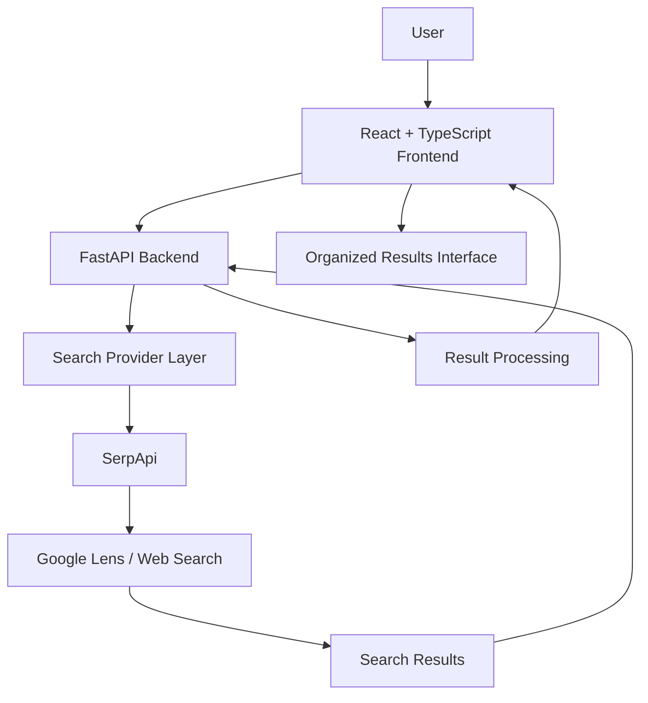

# 🔎 PhotoTrace AI
### AI-Powered Reverse Image & Name Search Platform

<p align="center">
  <a href="https://phototrace-ai.netlify.app/">
    
  </a>
  
  
  
</p>

<p align="center">
  <strong>Find connections across public web content through images and names.</strong>
  <br/>
  A full-stack search platform that combines reverse image search, visual similarity discovery, and name-based public web search in one experience.
</p>

<p align="center">
  <a href="https://phototrace-ai.netlify.app/">Live Application</a> •
  <a href="#-features">Features</a> •
  <a href="#-architecture">Architecture</a> •
  <a href="#-getting-started">Getting Started</a>
</p>

---

## ✨ Overview

**PhotoTrace AI** is a full-stack web application designed to help users discover publicly accessible web pages and images related to a photograph or a name.

Instead of manually searching across multiple sources, users can upload an image, search by name, or combine both inputs to explore potentially relevant results in one interface.

The project integrates a React-based frontend with a Python FastAPI backend and external search services to deliver a unified search experience.

> **Project goal:** Make public-web discovery more accessible through a simple, modern, AI-oriented search interface.

🔗 **Live Demo:** https://phototrace-ai.netlify.app/

---

## 🚀 Features

### 🖼️ Reverse Image Search

Upload a photograph to search for potentially matching or visually related images using an external search provider.

- Image upload and processing
- Exact-image match results when available
- Visually similar image discovery
- Links to original result pages where available

### 👤 Name-Based Search

Search public web content using a person's name or another relevant search term.

- Name-based search queries
- Public web result discovery
- Source links for further verification
- Results organized in a readable interface

### 🔗 Combined Image + Name Search

Combine a photograph with an optional name to explore different types of search results in one workflow.

| Result category | Purpose |
|---|---|
| Exact Image Matches | Images reported as exact or direct matches by the search provider |
| Visually Similar Images | Images that resemble the uploaded photograph |
| Name-Related Public Pages | Public web pages associated with the supplied search term |

These categories represent different kinds of evidence. A visual resemblance or a name match does not independently establish a person's identity.

### ⚡ Modern Search Experience

- Clean, responsive interface
- Dedicated search workflows
- Organized result categories
- Direct navigation to source pages
- Backend API integration
- Explicit distinction between demo data and live search results

---

## 🧰 Technology Stack

<table>
  <thead>
    <tr>
      <th>Layer</th>
      <th>Technologies</th>
    </tr>
  </thead>
  <tbody>
    <tr>
      <td>Frontend</td>
      <td>React, TypeScript, Vite</td>
    </tr>
    <tr>
      <td>Styling</td>
      <td>Tailwind CSS</td>
    </tr>
    <tr>
      <td>Backend</td>
      <td>Python, FastAPI</td>
    </tr>
    <tr>
      <td>Image Processing</td>
      <td>Pillow (PIL)</td>
    </tr>
    <tr>
      <td>External Search</td>
      <td>SerpApi, Google Lens search integration</td>
    </tr>
    <tr>
      <td>API Documentation</td>
      <td>FastAPI / OpenAPI / Swagger UI</td>
    </tr>
    <tr>
      <td>Frontend Hosting</td>
      <td>Netlify</td>
    </tr>
    <tr>
      <td>Backend Hosting</td>
      <td>Render</td>
    </tr>
  </tbody>
</table>

---

## 🏗️ Architecture

PhotoTrace AI separates the user interface, API layer, and external search integration.



### How it works

1. **Input:** The user submits an image, a name, or both.
2. **Request:** The frontend sends the search request to the FastAPI backend.
3. **Provider integration:** The backend communicates with the configured external search provider.
4. **Processing:** Returned results are processed and organized into relevant categories.
5. **Presentation:** The frontend displays available results and source links.

The availability and quality of results depend on the external provider, its index, configuration, and response.

---

## 🧠 Search Modes

### 1. Photo Search

Designed to discover exact-image matches and visually similar images from available search results.

### 2. Name Search

Designed to find public web pages relevant to a submitted name or search term.

### 3. Combined Search

Combines image-based discovery with name-related web search to provide additional context.

**Important:** PhotoTrace AI does not establish identity through facial biometric recognition. Similar-looking images, matching names, and search-engine results must not be treated as proof that two results refer to the same individual.

---

## 🖥️ Live Application & API

| Resource | Link |
|---|---|
| Live Website | [phototrace-ai.netlify.app](https://phototrace-ai.netlify.app/) |
| Backend API | [phototrace-backend.onrender.com](https://phototrace-backend.onrender.com) |
| Interactive API Documentation | [Swagger UI](https://phototrace-backend.onrender.com/docs) |
| Source Code | [GitHub Repository](https://github.com/Mohammad-Ali-SK/phototrace) |

The backend exposes versioned API routes, including:

- `POST /api/v1/search/photo`
- `POST /api/v1/search/name`
- `GET /api/v1/search/providers`

Use the Swagger documentation to inspect the current request schemas and supported options.

---

## ⚙️ Getting Started

Follow these steps to run the project locally.

### Prerequisites

Install the following:

- Node.js and npm
- Python 3.10 or a compatible version supported by the backend dependencies
- Git
- A SerpApi API key for live search functionality

### 1. Clone the repository

```bash
git clone https://github.com/Mohammad-Ali-SK/phototrace.git
cd phototrace
```

### 2. Configure the backend

```bash
cd backend
python -m venv .venv
```

Activate the virtual environment.

**Windows PowerShell**

```powershell
.\.venv\Scripts\Activate.ps1
```

**macOS / Linux**

```bash
source .venv/bin/activate
```

Install the backend dependencies:

```bash
pip install -r requirements.txt
```

Configure the backend environment variables using the project's supported configuration names. Check `.env.example` for the current list.

At minimum, live search requires the appropriate SerpApi configuration. Set a strong, randomly generated `SECRET_KEY` for the application.

**Never commit `.env` files, API keys, or production secrets to GitHub.**

### 3. Start the backend

From the `backend` directory:

```bash
uvicorn app.main:app --reload
```

The API should be available at:

```text
http://localhost:8000
```

Open the interactive API documentation:

```text
http://localhost:8000/docs
```

### 4. Configure the frontend

Open a new terminal and return to the project root.

Install dependencies:

```bash
npm install
```

Create a `.env` file in the frontend project root and configure the API URL:

```env
VITE_API_URL=http://localhost:8000
```

The production deployment should use the deployed backend URL instead.

### 5. Run the frontend

```bash
npm run dev
```

Open the local URL printed by Vite in your terminal.

### 6. Build for production

```bash
npm run build
```

Vite generates the production build in the `dist` directory.

> **Note:** This guide assumes the frontend `package.json` is in the repository root. If your repository uses a different directory structure, run the frontend commands from the directory containing its `package.json`.

---

## 🔐 Configuration & Security

PhotoTrace AI uses environment-based configuration for its backend and frontend deployments.

| Variable | Purpose |
|---|---|
| `SERPAPI_API_KEY` | Enables requests to the configured SerpApi integration |
| `SECRET_KEY` | Application secret used by the backend |
| `VITE_API_URL` | Backend API base URL used by the frontend |
| `SEARCH_PROVIDER` | Search-provider selection, where supported by the backend configuration |

Consult `.env.example` and the backend configuration module for the complete, authoritative list of environment variables.

### Security principles

- Keep API keys and application secrets on the backend.
- Never expose private credentials in frontend code.
- Configure CORS to allow only the intended frontend origins.
- Validate uploaded images and incoming API requests.
- Avoid treating search results as verified identity claims.
- Respect source websites' access restrictions, terms, and applicable privacy laws.

---

## 🧪 Testing & Quality

The project has included automated frontend and backend tests during development.

Areas covered by the test suite have included:

- Search request handling
- Image orientation processing
- Search result processing
- Provider-related behavior
- Frontend search workflows

Run the tests using the commands and test dependencies defined by the repository. A passing test suite does not by itself guarantee that external search credentials, deployed integrations, or every production workflow are functioning correctly.

---

## ⚠️ Limitations

PhotoTrace AI is a public-web discovery tool, not an identity verification system.

- Exact-image matches depend on what the search provider can find.
- Visually similar results may depict completely different people.
- Name-based results may refer to different people with the same name.
- Some pages or images may be inaccessible, removed, or absent from search indexes.
- External search services may impose quotas, usage limits, or costs.
- Demo results, when shown, are examples and must not be interpreted as live discoveries.
- A result appearing on a public webpage does not automatically grant permission to reuse its content.

---

## 🗺️ Roadmap

Potential future improvements include:

- [ ] More robust search-result filtering and ranking
- [ ] Clearer provenance and source attribution
- [ ] Improved handling of unavailable or failed search providers
- [ ] Expanded test coverage for live API integrations
- [ ] Search history and account workflows
- [ ] Better accessibility and mobile usability
- [ ] More comprehensive deployment and monitoring documentation

Roadmap items are planned improvements and should not be interpreted as currently available features.

---

## 💡 What This Project Demonstrates

PhotoTrace AI brings together several practical full-stack engineering concepts:

- Building a responsive React and TypeScript application
- Designing API endpoints with FastAPI
- Integrating an external search provider
- Processing uploaded images
- Organizing heterogeneous search results
- Configuring frontend and backend deployments
- Managing environment variables and production configuration
- Communicating uncertainty and limitations in search results

The project explores how modern web interfaces and external search services can work together to make information discovery more accessible.

---

## 🤝 Contributing

Contributions, bug reports, and suggestions are welcome.

1. Fork the repository.
2. Create a feature branch.
3. Make your changes and add appropriate tests.
4. Verify the production build and relevant test suites.
5. Submit a pull request describing the changes.

Please avoid submitting API keys, personal information, or private credentials in issues and pull requests.

---

## 📜 License

No license has been specified in this README. Add an appropriate `LICENSE` file to clarify the permissions for using, modifying, and distributing this project.

---

## 👨‍💻 Author

**Developed as a full-stack AI-oriented web application project.**

GitHub: [Mohammad-Ali-SK](https://github.com/Mohammad-Ali-SK)

Project: [PhotoTrace AI](https://phototrace-ai.netlify.app/)

---

<p align="center">
  <strong>PhotoTrace AI</strong>
  <br/>
  Discover connections. Explore public information. Verify every result.
</p>
